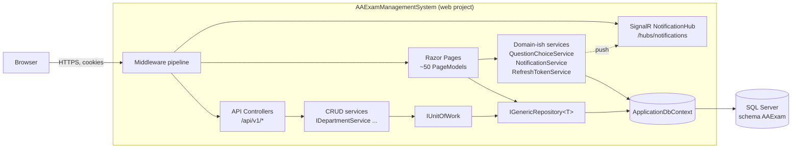
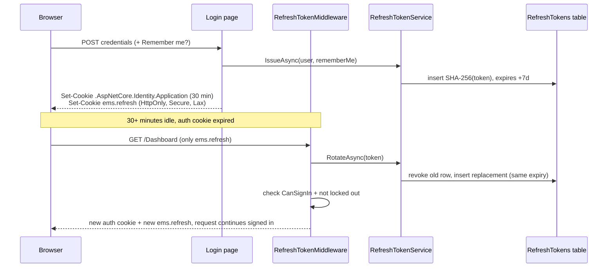
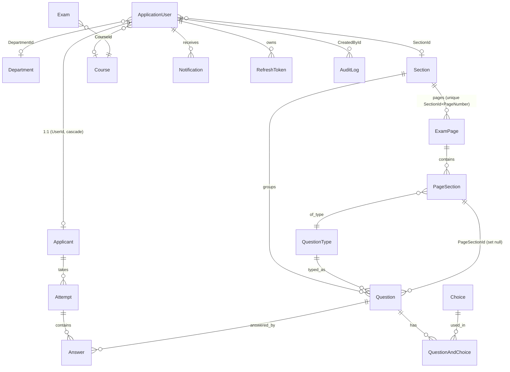
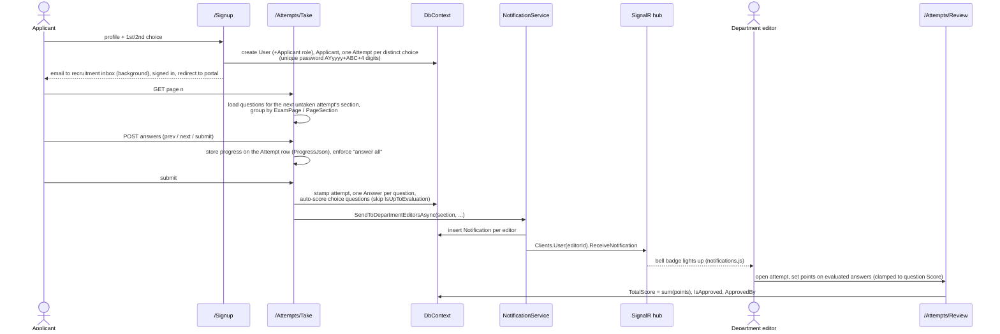

# Ad Astra Exam Management System — Architecture

*Written 2026-10-26 from the code on `main` (commit `b44a76f`). Everything below was read from the source; where something is a judgement rather than a fact, it says so.*

---

## 1. What the system is

A server-rendered ASP.NET Core web application (.NET 10) for running entrance exams for an academic recruitment process.

| Who | What they do |
|---|---|
| **Applicant** | Registers on `/Signup`, logs in at `/ApplicantLogin`, takes one exam per chosen department, sees scores in the portal. |
| **Editor** (department staff) | Reviews submitted attempts for their department, grades free-text answers, approves attempts, authors questions, gets live notifications. |
| **Instructor / Staffer** | Question authoring and attempt review (same page set as Editor, minus a few). |
| **Admin** | Everything above plus master data (departments, sections, courses, roles, users, role assignments, announcements, audit log). |

**Stack:** ASP.NET Core Razor Pages + a versioned REST API, ASP.NET Core Identity (cookie auth), EF Core 10 on PostgreSQL (Supabase, Npgsql provider), SignalR for push notifications, AutoMapper for DTO mapping, xUnit + Moq + EF InMemory for tests, Docker for deployment. Front end is Bootstrap 5 + Bootstrap Icons + SweetAlert, with a few small hand-written JS files.



---

## 2. Solution layout

`AAExamManagementSystem.slnx` contains four projects. Dependencies point one way:

```
AAExamManagementSystem (web)  ──►  AAExamManagementSystem.Repository  ──►  AAExamManagementSystem.Models
        ▲                                                                           ▲
        └───────────────────────────  AAExamManagementSystem.Tests  ────────────────┘
```

| Project | Responsibility | Notable contents |
|---|---|---|
| **`.Models`** | Pure data shapes. No EF, no web. | `Entities/` (25 files, including the static helpers below), `Dtos/` (one file per aggregate, each holding a read DTO and a `…CreateUpdateDto`), `Mapping/MappingProfile.cs` (single AutoMapper profile). |
| **`.Repository`** | Persistence. | `ApplicationDbContext`, `IGenericRepository<T>` / `GenericRepository<T>`, `IUnitOfWork` / `UnitOfWork`, `IRoleRepository` / `RoleRepository`, EF `Migrations/`. |
| **`AAExamManagementSystem`** (web) | Everything the user or an API client touches. | `Program.cs`, `Pages/`, `Controllers/`, `Services/`, `Hubs/`, `Data/IdentitySeeder.cs`, `ViewComponents/`, `TagHelpers/`, `wwwroot/`. |
| **`.Tests`** | 19 test files (about 270 test cases including theories). | Page-model tests invoke handlers directly with a fake `HttpContext`; service tests run against EF InMemory. |

Constants that behave like enums live in `Models/Entities`: `Roles` (7 role names), `Departments` (seeded department names), `QuestionTypes` (seeded question types and helpers like `RequiresChoices`), and `AttemptPassword` (password generator, pure function).

---

## 3. Startup and request pipeline

All wiring is in [`Program.cs`](../AAExamManagementSystem/Program.cs).

**Service registration**

| Area | Registration |
|---|---|
| UI | `AddRazorPages` with `AuthorizeFolder("/")` — **everything requires login unless allow-listed**: `/Index`, `/Login`, `/ApplicantLogin`, `/Signup`, `/ForgotPassword*`, `/ResetPassword*`. |
| API | `AddControllers` + `AddApiVersioning` (default `1.0`, route `api/v{version}/[controller]`). |
| Real time | `AddSignalR`. |
| Data | `AddDbContext<ApplicationDbContext>` (PostgreSQL via Npgsql); `DbContext` is also aliased to the same instance so the generic repository can take a plain `DbContext`. |
| Identity | `AddIdentity<ApplicationUser, ApplicationRole>` + EF stores + default token providers. Cookie: `/Login`, 30-minute sliding expiry. |
| Data access | `IGenericRepository<>` → `GenericRepository<>` (open generic), `IUnitOfWork` → `UnitOfWork`. All scoped. |
| Services | `IRoleService`, `ISectionService`, `IDepartmentService`, `ICourseService`, `IChoiceService`, `IQuestionService`, `QuestionChoiceService`, `NotificationService`, `IRefreshTokenService`. |
| Misc | AutoMapper, `EmailSettings` (+ SMTP notifier), `TimeProvider.System`. |

**On boot** (before the pipeline is built): `db.Database.Migrate()` then `IdentitySeeder.SeedAsync` — roles, departments, question types, sidebar `WebPage` rows, an admin user, demo users, department editors, and a large set of seeded exam questions. Migrations therefore apply automatically on every deploy.

**Middleware order**

```
ExceptionHandler/HSTS (non-dev) → HttpsRedirection → Routing
  → Authentication → RefreshTokenMiddleware → Authorization
  → StaticAssets / RazorPages / Controllers / SignalR hub
```

`RefreshTokenMiddleware` has to sit directly after `UseAuthentication` so that it can see "not authenticated" and repair it before `UseAuthorization` runs (§4.3).

Configuration: `appsettings.json` (connection string, `Email`, `RefreshToken`), `appsettings.Development.json`, and a git-ignored `.env` loaded by `EnvFileConfiguration` (holds the Gmail app password under key `ad-astra-exam-password`).

---

## 4. Authentication and authorization

### 4.1 Identity model

* `ApplicationUser : IdentityUser` adds `FirstName`, `LastName`, `Title`, and three nullable FKs — `DepartmentId`, `SectionId`, `CourseId`.
* `ApplicationRole` adds `IsActive`, `CreatedAt`, `DateUpdated`.
* `ApplicationUserRole` (the join table) adds `IsActive` and timestamps. A **global query filter** (`HasQueryFilter(ur => ur.IsActive)`) hides inactive assignments, so deactivating a role assignment removes the role from the user without deleting history.
* Roles are the string constants in `Roles.cs`: Admin, Instructor, Student, Applicant, Staffer, Editor, Guest.

### 4.2 Two login doors

| Page | Allows | Rejects |
|---|---|---|
| `/Login` | Staff | Applicants — signed back out with "Applicants must sign in from the Applicant Login page." |
| `/ApplicantLogin` | Only users in role `Applicant` | Everyone else, with the same generic message as a bad password. |

Both use `PasswordSignInAsync(..., lockoutOnFailure: true)` and write an `AuditLog` row for every attempt, success or failure.

### 4.3 Refresh token (added in this session)

Goal: short-lived auth cookie, long-lived (7-day) silent renewal.



Key rules (all in [`RefreshTokenService.cs`](../AAExamManagementSystem/Services/RefreshTokenService.cs)):

* **Opaque, hashed.** 64 random bytes, base64. Only the SHA-256 hash is stored, so a database leak does not yield usable tokens.
* **Single use, rotating.** Each refresh revokes the presented token and issues a replacement.
* **Reuse detection.** Presenting an already-revoked token is treated as theft and revokes every token that user holds.
* **Hard 7-day cap.** The replacement inherits the original `ExpiresAt`, so continuous use cannot extend a session past 7 days from the login.
* **Remember-me respected.** `IsPersistent` is stored on the token; unticked, both cookies are session cookies.
* **Revocation points.** Logout (token + cookie), password reset (all tokens), lockout/disabled user (token revoked, cookie deleted).
* **Housekeeping.** `IssueAsync` deletes that user's expired/revoked rows.

`RefreshToken` has a cascade FK to the user and a unique index on `TokenHash`.

### 4.4 Authorization

* **Razor Pages:** every `PageModel` carries `[Authorize(Roles = …)]`. Admin-only: all master-data CRUD, users, roles, audit logs, announcements. Admin+Instructor+Staffer+Editor: questions, page sections, attempts index/review, analytics. Admin+Editor: applicants, simulate. Applicant-only: portal, take exam, my attempts. Editor-only: `/Staff`.
* **API controllers:** the management controllers (`Announcements`, `Choices`, `Courses`, `Departments`, `Questions`, `Sections`) are restricted to Admin and Editor; `Roles` and `RoleAssignments` to Admin. `Notifications` and `WebPages` remain plain `[Authorize]`.
* **SignalR hub:** `[Authorize]`; messages are addressed with `Clients.User(userId)`.
* **Data scoping:** department editors only see applicants/attempts for their own section (checked in `Applicants/*` and `Attempts/Review`).
* The sidebar is a hand-written partial that hides links by role; a `WebPage` table (seeded) also stores nav entries with icon/category/order.

---

## 5. Domain model

Primary keys are a mix of `int`, `Guid`, and `string` (GUID-as-string). That is inherited from the migration history and is worth knowing when writing queries.



**Aggregates in plain words**

* **Organisation:** `Department`, `Section`, `Course`. In practice *Section* is what the exam flow calls a department (Web Dev, Video, …); `Departments.All` seeds `Section` rows and `NotificationService.SendToDepartmentEditorsAsync` matches editors by `SectionId`. `Department` is a separate master-data table also hung off the user. Expect to meet both words.
* **Question bank:** `Question` → `QuestionType`, `Section`, optional `PageSection`. Choices are many-to-many through `QuestionAndChoice` (cascade both ways), so one `Choice` row can be reused. `IsUpToEvaluation` marks questions a human must score (essays).
* **Exam layout:** `ExamPage` (a numbered page within a section's exam) → `PageSection` (an ordered block with its own instruction text and question type) → `Question`. `Take` renders pages in that order.
* **Applicant journey:** `Applicant` (profile, 1:1 with a user) → `Attempt` (one per chosen department; created at signup with a generated password) → `Answer` (one per question).
* **Cross-cutting:** `AuditLog`, `Notification`, `Announcement`, `WebPage`, `RefreshToken`.

**Database conventions** (`ApplicationDbContext`)

* Default schema **`AAExam`** (including Identity tables).
* **Soft-delete flag** `IsActive` on nearly every table, plus `DateCreated`/`DateUpdated` (or `CreatedAt`/`DateUpdated` on older tables). Enforced by a global query filter on `ApplicationUserRole`, `Department`, `Course` and `Section`, so inactive rows stay out of dropdowns and lookups by default. Admin lists use `GetAllIncludingInactiveAsync()` and the seeder uses `IgnoreQueryFilters()`; `GetByIdAsync` also ignores the filter so an inactive row can be opened and reactivated. `Question`, `Choice`, `ExamPage` and `PageSection` are deliberately **not** filtered (graded answers must still resolve their question; page numbers are unique per section), so those callers still filter `IsActive` themselves.
* Delete behaviour: `Restrict` on anything with history (questions, answers, attempts, exam pages); `Cascade` for owned children (question-choice links, answers under an attempt, notifications, refresh tokens, the applicant under a user); `SetNull` for optional user links.
* Unique indexes: `Attempt.Password`, `WebPage.Url`, `ExamPage(SectionId, PageNumber)`, `Applicant.UserId`, `RefreshToken.TokenHash`.
* Migrations: 26, timestamped, in `Repository/Migrations`. Newest: `AddRefreshTokens`.

---

## 6. The CRUD pattern

There are **two parallel CRUD paths** over the same entities. Understanding which is which is the single most useful thing to know before changing code.

### 6.1 Path A — Razor Pages (the UI)

Used by every admin screen. A page model injects `IGenericRepository<T>` and `IMapper` directly (or `UserManager`/`RoleManager` for Identity entities, or `ApplicationDbContext` for anything with joins). **No service layer is involved.** Using Departments as the template:

| File | Handler(s) | What it does |
|---|---|---|
| `Departments/Index.cshtml.cs` | `OnGet`, `OnPostCreate`, `OnPostDeactivate`, `OnPostActivate` | List (ordered by name), create via modal, toggle `IsActive`. |
| `Departments/Edit.cshtml.cs` | `OnGet`, `OnPost` | Load into `…CreateUpdateDto`, validate, copy fields, set `DateUpdated`, save. |
| `Departments/Details.cshtml.cs` | `OnGet` | Read-only DTO display. |
| `Departments/Index.cshtml` | — | Renders the list with the **`EntityTable` view component**. |

Shared UI building blocks keep the screens uniform:

* **`EntityTable` view component** — one configurable table/toolbar/modal host (`tableId`, `basePath`, status/date columns, SweetAlert confirm on delete/create, soft vs hard delete wording). Rows are a small `EntityTableRow` record, so any entity can be shown by projecting to it.
* **`DetailsCard` view component** and **`<edit-card>` tag helper** — consistent details and edit shells.
* **`StatusPill` view component** — Active/Inactive badge.
* `TempData["SuccessMessage"]` + `_SuccessToast` partial — post-redirect-get feedback.

Typical handler shape:

```csharp
var entity = await _repository.GetByIdAsync(id);     // FindAsync
if (entity is null) return NotFound();
entity.Name = dto.Name;                              // manual field copy on update
entity.DateUpdated = DateTime.UtcNow;
_repository.Update(entity);
await _repository.SaveChangesAsync();
TempData["SuccessMessage"] = "...";
return RedirectToPage("Index");                      // PRG
```

Create uses `_mapper.Map<Entity>(dto)` → `AddAsync` → `SaveChangesAsync`. Reads map entity → read-DTO with AutoMapper so views never bind to entities.

**Identity entities** (Users, Roles, RoleAssignments) go through `UserManager`/`RoleManager` rather than the repository, because those own password hashing, normalized names and role bookkeeping.

**Delete semantics are per-entity, not uniform:**

| Entity | Delete does |
|---|---|
| Department, Section, Course, Role, Announcement, … | Soft: `IsActive = false` (Index has Activate/Deactivate). |
| Choice, Question, User | Hard `Remove`/`DeleteAsync` after a confirmation page (`Delete.cshtml`). |

### 6.2 Path B — REST API (`/api/v1/*`)

Ten controllers: Announcements, Choices, Courses, Departments, Notifications, Questions, RoleAssignments, Roles, Sections, WebPages. They are thin and always go **controller → service → unit of work → generic repository → DbContext**.

```
DepartmentsController   [ApiController, ApiVersion 1.0, Authorize]
   GET    /api/v1/departments        → GetAllAsync
   GET    /api/v1/departments/{id}   → GetByIdAsync        (404 if null)
   POST   /api/v1/departments        → CreateAsync         (201 + Location)
   PUT    /api/v1/departments/{id}   → UpdateAsync         (204 / 404)
   DELETE /api/v1/departments/{id}   → DeleteAsync (soft)  (204 / 404)
```

* **Service layer** (`IDepartmentService`, …) holds the logic: DTO ⇄ entity mapping, uniqueness checks, soft delete, timestamps.
* **`ServiceResult` / `ServiceResult<T>`** is the return type for anything that can fail: `Success | NotFound | Invalid(error) | ValidationFailed(ModelState)`. Controllers translate it to `NoContent`, `NotFound`, `BadRequest(message)` or a `ValidationProblem` — services never reference HTTP types, only `ModelStateDictionary`.
* **`IUnitOfWork`** exposes the repositories (`Roles`, `Sections`, `Departments`, `Courses`, `Questions`, `QuestionTypes`, `Choices`), each created lazily and sharing one `DbContext`, with a single `SaveChangesAsync()`.
* **`IGenericRepository<T>`** is five operations: `GetByIdAsync`, `GetAllAsync`, `AddAsync`, `Update`, `Remove`, plus `SaveChangesAsync`. Specialisations override just what they need — `RoleRepository` adds `NameExistsAsync` and keeps Identity's `NormalizedName` in sync on add/update.
* **Validation** is DataAnnotations on the `…CreateUpdateDto` classes (`[Required, StringLength]`), enforced by `[ApiController]` on the API and by `ModelState` on the pages — one set of rules for both paths.

### 6.3 The question aggregate (the one place with real logic)

`QuestionService` + `QuestionChoiceService` are the most developed CRUD. Create/update must:

1. **Normalize** the submitted choices — drop blank rows, clear choices entirely for question types that do not use them (`QuestionTypes.RequiresChoices`).
2. **Validate** — between `MinimumChoices = 2` and `MaximumChoices = 4`, with a correct answer, errors keyed by `ModelState` prefix so the same method serves a Razor form (`"Question."`) and the API (`""`).
3. **Persist atomically** — add/update the question, `ReplaceChoicesAsync` (creates `Choice` + `QuestionAndChoice` rows, does *not* save), then one `SaveChangesAsync`.
4. **Delete** removes link rows and their choices first, then the question.

Because `QuestionChoiceService` is registered concretely and injected into pages directly (`Questions/*`, `Attempts/Take`), this is the one service the UI *does* share with the API.

### 6.4 Why both paths exist (and the cost)

The services came with the API and are covered by unit tests; the pages were built to call the repository directly. The result is that rules like "role names must be unique" or "update stamps `DateUpdated`" are **written twice** (e.g. `RoleService.UpdateAsync` and `Roles/Edit.cshtml.cs`). (the page version goes through `RoleManager` rather than the repository, so even the mechanics differ). They agree today, but a change to one will not reach the other. See §10 for the recommended consolidation.

---

## 7. Key flows

### 7.1 Applicant registration → exam → review



Details worth knowing:

* **Progress lives on the `Attempt` row** (`ProgressJson`, cleared on submit), so it survives restarts and works across several instances. Applicants who registered before signup created their attempts get one on their first saved page.
* Notification failures are caught and logged; they never fail a submission.
* Signup is compensating rather than transactional: if saving the applicant fails, the just-created `ApplicationUser` is deleted.
* Attempt passwords are generated by the pure `AttemptPassword` helper and checked for uniqueness against the DB and the in-flight batch.

### 7.2 Notifications

`NotificationService.SendAsync` persists a `Notification` row **then** pushes the DTO over SignalR to `Clients.User(userId)` (user id comes from the auth cookie's name identifier). The browser does both: on page load it hits `GET /api/v1/notifications` and `/unread-count`, and a SignalR connection delivers new ones live. Read state is `POST /{id}/read` and `/read-all` (a single `ExecuteUpdateAsync`). `notifications.js` builds DOM with text nodes, so user-entered names cannot inject HTML.

### 7.3 Audit logging

`AuditLog` rows are written inline by the login, applicant-login and logout pages (`Type` = "Login"/"Logout", free-text `ResponseBody`, `IsActive` doubles as success flag for logins). `/AuditLogs` (Admin) lists them. Other CRUD is **not** audited.

---

## 8. Front end

* Layouts: `_Layout` (staff, sidebar + top bar + notification bell), `_ApplicantLayout`, `_ExamLayout` (exam taking, with `_ExamQuestionHeader` / `_ExamSectionHeading` partials for per-section instructions and hero images via `ExamHeroImage`).
* JS is small and page-specific: `notifications.js`, `question-choices.js` (dynamic choice rows), `sidebar.js`, `sweetalert-toast.js`, `clock.js`, `navbar-search.js`. There is no SPA framework or bundler; libraries sit in `wwwroot/lib`.
* Anti-forgery is automatic for Razor Page forms. API calls from the browser are same-origin `fetch` with cookies.

---

## 9. Testing, build and deployment

**Tests** (`AAExamManagementSystem.Tests`, xUnit):

| Style | Examples | How |
|---|---|---|
| Service tests | `DepartmentServiceTests`, `RoleServiceTests`, `QuestionServiceTests`, `ChoiceServiceTests` | Real service + real `UnitOfWork` over EF InMemory. |
| Page-model tests | `LoginTests`, `ApplicantsPageTests`, `ExamPageOrderingTests` | Build the model with mocked `UserManager`/`SignInManager`, attach a fake `HttpContext` with `TestSupport.Attach`, call handlers. |
| Security | `AuthorizationTests` | Reflects over page models to assert `[Authorize]` role sets. |
| Model/data | `ModelRelationshipTests`, `SeededExamDataTests`, `AttemptPasswordTests`, DTO validation | Asserts FK wiring, seed content, generator output. |
| Refresh token | `RefreshTokenTests`, additions to `LoginTests` | Fake `TimeProvider`; covers rotation, expiry, reuse detection, logout, middleware. |

Not covered by tests: the real middleware pipeline end to end, SignalR delivery, PostgreSQL specifics (InMemory ignores FKs, unique indexes and query-filter edge cases).

**Run:** `dotnet run --project AAExamManagementSystem`. **Docker:** multi-stage `Dockerfile` (SDK 10 build → ASP.NET 10 runtime), listening on 8080. The container applies migrations and seeds on start, so it needs a reachable PostgreSQL database and the connection string/env secrets.

---

## 10. Known gaps and recommendations

Ordered roughly by how much they matter. These are observations from reading the code, not bugs I have reproduced.

1. ~~**API authorization is authentication-only.**~~ Fixed: management controllers now carry role restrictions (see §4.4).
2. **Seeded admin password is hard-coded** (`IdentitySeeder`: `P@ssword2026!`) and runs in every environment, including production. Read it from configuration and skip demo-user seeding outside Development.
3. **Two CRUD paths duplicate business rules** (§6.4). Pick one: have page models call the existing `I…Service` interfaces (they already return `ServiceResult` suitable for `ModelState`), and keep repositories behind the services.
4. ~~**Soft delete is a convention, not a guarantee.**~~ Fixed for departments, courses and sections with global query filters (see §5). Questions, choices, exam pages and page sections still rely on callers filtering `IsActive`, for the reasons given there.
5. ~~**Exam progress in `Session` + in-memory cache**~~ Fixed: progress is stored on the attempt (`Attempt.ProgressJson`) and session state is no longer used.
6. **`Attempt.Section` is a string and `Attempt.DateTaken` is an ISO string.** A section FK and a `DateTime?` would remove string matching in notifications and sorting.
7. **`Department` vs `Section` overlap** (§5). Decide whether they are one concept; today editors are scoped by `SectionId` while `Department` is mostly decorative.
8. **No audit trail for data changes**, only logins/logouts. If the audit log is meant for compliance, a `SaveChanges` interceptor writing `AuditLog` rows would cover all CRUD uniformly.
9. **Startup does migrate + seed unconditionally.** Fine for a single instance; with several instances starting together, run migrations as a separate deploy step.
10. **Refresh-token follow-ups:** the `ems.refresh` cookie is `Secure`, so plain-HTTP dev (non-HTTPS profile) will not keep it; no admin "sign out everywhere" action exists yet though `RevokeAllAsync` is ready; a scheduled purge of long-expired rows would complement the per-login cleanup.

---

## Appendix — where to look

| I want to… | Start at |
|---|---|
| Add a new master-data entity | `Models/Entities` → `DbContext` (+ migration) → `Dtos` + `MappingProfile` → `Pages/<Entity>/` copying `Departments/` → optionally controller + service. |
| Change who can open a page | `[Authorize(Roles = …)]` on the page model; update `Sidebar` and `AuthorizationTests`. |
| Change login/session lifetime | `ConfigureApplicationCookie` and `RefreshToken:LifetimeDays` (`Program.cs`, `appsettings.json`). |
| Change exam content | `IdentitySeeder` (`Seed…Questions`), `ExamPage`/`PageSection` tables, `Questions/*` pages. |
| Send a notification | `NotificationService.SendAsync(userId, title, message, url)`. |

## Database providers (PostgreSQL / SQL Server)

The app runs on Supabase PostgreSQL or SQL Server. `Program.cs` picks the provider from `Database:Provider` (`Postgres` or `SqlServer`), or infers it from `ConnectionStrings:DefaultConnection`: a string starting with `Host=` is PostgreSQL, anything else is SQL Server. Each provider's migrations live in their own project, because EF cannot keep two providers' migrations in one assembly:

- `AAExamManagementSystem.Migrations.Postgres`: one `InitialCreate` for Supabase / Render.
- `AAExamManagementSystem.Migrations.SqlServer`: the original migration history for local SQL Server.

After a model change, add a migration to **both** projects (set the matching connection string first, for example via user secrets or `ConnectionStrings__DefaultConnection`):

```
dotnet ef migrations add <Name> --project AAExamManagementSystem.Migrations.Postgres --startup-project AAExamManagementSystem
dotnet ef migrations add <Name> --project AAExamManagementSystem.Migrations.SqlServer --startup-project AAExamManagementSystem
```

Local SQL Server keeps its connection string in user secrets. A `ConnectionStrings__DefaultConnection` environment variable overrides user secrets, so use it for one-off Supabase commands.
